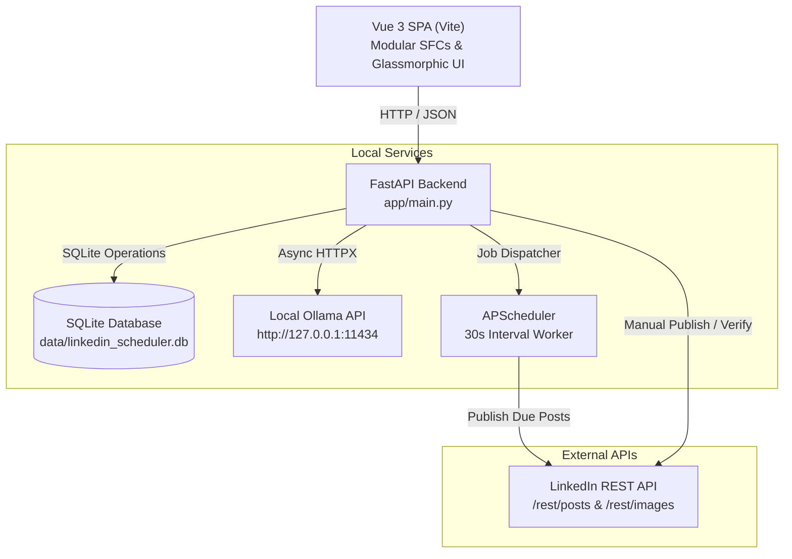

# LinkedIn AI Ghostwriter & Scheduler

[](https://www.python.org/)
[](https://fastapi.tiangolo.com/)
[](https://vuejs.org/)
[](https://vitejs.dev/)
[-white?style=flat&logo=ollama&logoColor=black)](https://ollama.ai/)
[](https://learn.microsoft.com/en-us/linkedin/)
[](LICENSE)

A privacy-focused, local-first web application designed to craft high-impact LinkedIn content with a self-hosted LLM (Ollama), preview posts inside a pixel-accurate LinkedIn feed simulator, and schedule or publish them directly using the official LinkedIn REST API.

---

## Table of Contents

- [Overview](#overview)
- [Key Features](#key-features)
- [System Architecture](#system-architecture)
- [Tech Stack](#tech-stack)
- [Prerequisites](#prerequisites)
- [Getting Started](#getting-started)
- [Configuration & Environment Variables](#configuration--environment-variables)
- [LinkedIn Developer Setup](#linkedin-developer-setup)
- [REST API Reference](#rest-api-reference)
- [Project Structure](#project-structure)
- [Security & Privacy](#security--privacy)
- [Troubleshooting](#troubleshooting)
- [License](#license)

---

## Overview

Writing consistently on LinkedIn usually requires choosing between expensive cloud-based SaaS tools or manual drafting without realistic feedback. **LinkedIn AI Ghostwriter & Scheduler** provides a self-hosted solution:

1. **Local-first AI generation**: Generates post variations locally with zero token fees and zero data leakage.
2. **Context-aware engineering tone**: Tuned to avoid generic AI clichés ("In today's fast-paced world...", "Game-changer") in favor of punchy, peer-to-peer insights, clean bullet points, and authentic hooks.
3. **Realistic feed preview**: Simulates the mobile "...see more" cutoff (~210 characters), reaction counters, and author branding before publishing.
4. **Autonomous scheduling**: An embedded background worker continuously evaluates scheduled posts and dispatches them via the LinkedIn API.
5. **Modern Vue 3 SPA**: Clean, component-based frontend built with Vue 3, Vite, and dark glassmorphic styling for optimal developer experience and responsiveness.

---

## Key Features

### 🧠 Local AI Ghostwriting (Ollama)
- **Batch generation**: Generate 1, 3, or 5 distinct variations from a single prompt or topic.
- **Strategic angles**:
  - `Practical Insight`: Production war stories and pragmatic takeaways.
  - `Framework / Strategy`: Step-by-step methodologies and mental models.
  - `Story & Lessons`: Relatable narratives detailing setbacks and solutions.
  - `Contrarian View`: Thoughtful challenges to common industry assumptions.
  - `Checklist`: Scannable action items and best-practice audits.
- **Automated tag generator**: Proposes 3–5 high-visibility, relevant hashtags automatically appended to each post.
- **Sanitized formatting**: Automatically cleans markdown double asterisks (`**bold**`), replacing them with clean plain text or Unicode bullets (`•`) to ensure natural rendering in the LinkedIn feed.

### ⚡ One-Click Refiners
Fine-tune any draft with pre-built tactical prompt modifiers:
- **Make it punchier**: Shortens sentences, tightens rhythm, and cuts filler words.
- **Add engagement question**: Appends an authentic discussion prompt at the end.
- **Format as bullets**: Restructures key points into scannable lists.
- **Shorten & condense**: Trims verbosity while preserving core insights.
- **Custom instruction**: Free-form prompt refinement directly against your local model.

### 👁️ Pixel-Accurate Feed Simulator
- Displays live mobile preview with author avatar, verified badges, headline, and timestamp.
- **"...see more" fold cutoff calculation**: Accurately shows where LinkedIn collapses text, helping you optimize your hook.
- **Inline post editing**: Edit drafts directly inside the simulator card with live character and tag synchronization.
- **Interactive hashtag chips**: Add custom tags or delete proposed tags with 1-click.
- Image attachment preview with 1-click removal.

### ⚡ Modular Vue 3 Architecture
- Built with **Vue 3 (`<script setup>`)** and **Vite** for rapid hot-reloading.
- **Single Responsibility Components**: Studio, Queue, Settings, Feed Simulator, and Modals decomposed into maintainable Single File Components.
- **Responsive design**: Built-in breakpoints for mobile, tablet, and desktop ensuring panels never overlap or clip on smaller screens.
- **Global reactive state**: Powered by the `useApp` composable for streamlined state sharing without heavy boilerplate.

### 📅 Queue & Scheduler
- **Autonomous background dispatcher**: Powered by APScheduler running an asynchronous loop every 30 seconds.
- **State machine**: Tracks posts through `draft`, `scheduled`, `published`, and `failed` states with error logging.
- **Instant publishing**: "Publish Now" button for immediate manual dispatch.
- **Dynamic filters**: Filter by status (`All`, `Scheduled`, `Drafts`, `Published`, `Failed`) or search by keyword.

### 🖼️ Image Upload Pipeline
- Supports image attachments (`.png`, `.jpg`, `.jpeg`, `.webp`, `.gif`) up to 15MB.
- Orchestrates LinkedIn's two-step binary upload process (`/rest/images` initialization followed by raw binary streaming).

### ⚙️ Settings & Auto-Sync
- **Model discovery**: Automatically queries Ollama's local registry (`/api/tags`) to populate available models.
- **LinkedIn verification**: Validates OAuth tokens against OpenID (`/v2/userinfo`) and `/v2/me` endpoints, automatically pulling your display name, headline, avatar, and Person URN.

---

## System Architecture




---

## Tech Stack

| Component | Technology | Purpose |
| :--- | :--- | :--- |
| **Backend** | Python 3.10+ / 3.14+, FastAPI | High-performance asynchronous REST API |
| **Database** | SQLite3, Pydantic v2 | Local zero-configuration relational storage & schema validation |
| **Scheduler** | APScheduler 3.10+ | Embedded background job runner |
| **HTTP Client**| HTTPX | Non-blocking async client for Ollama and LinkedIn API calls |
| **Frontend** | Vue 3, Vite, Single File Components | Modular, responsive dark-glassmorphic SPA with Composition API |
| **AI Provider**| Ollama (`qwen2.5:14b` default) | Self-hosted LLM execution |
| **Integration**| LinkedIn REST API (Version 202401+) | Direct social media publishing and profile synchronization |

---

## Prerequisites

1. **Python 3.10+** (tested up to Python 3.14).
2. **Node.js 18+** & **npm** (for building/running the Vue frontend).
3. **Ollama** installed and running:
   ```bash
   ollama serve
   ```
   Pull your preferred model (e.g., `qwen2.5:14b` or `llama3.1:8b`):
   ```bash
   ollama pull qwen2.5:14b
   ```
4. A **LinkedIn Developer Access Token** with post publishing permissions (`w_member_social`).

---

## Getting Started

### 1. Clone the repository
```bash
git clone https://github.com/asafecesar/linkedin-scheduler.git
cd linkedin-scheduler
```

### 2. Set up a virtual environment
```bash
python3 -m venv .venv
source .venv/bin/activate  # On Windows: .venv\Scripts\activate
```

### 3. Install dependencies & build frontend
```bash
# Python backend dependencies
pip install -r requirements.txt

# Vue frontend build
cd frontend && npm install && npm run build && cd ..
```

### 4. Start the application
Using the automated startup script:
```bash
chmod +x start.sh
./start.sh
```

Or directly via Python:
```bash
python run.py
```

For frontend development with Vite hot module replacement (HMR):
```bash
cd frontend && npm run dev
# Runs on http://localhost:5173 with auto-proxy to FastAPI on port 8000
```

Open your browser at **[http://127.0.0.1:8000](http://127.0.0.1:8000)**.  
Interactive API documentation is available at **[http://127.0.0.1:8000/docs](http://127.0.0.1:8000/docs)**.

---

## Configuration & Environment Variables

Configuration can be managed directly via the **Settings UI** or through environment variables. Environment variables take precedence when set.

| Variable | Default | Description |
| :--- | :--- | :--- |
| `LINKEDIN_ACCESS_TOKEN` | *None* | LinkedIn OAuth2 user token with publishing scopes |
| `LINKEDIN_PERSON_URN` | *None* | LinkedIn Person identifier (e.g. `urn:li:person:abcdef123`) |
| `DATA_DIR` | `./data` | Directory where SQLite database and runtime files are stored |
| `HOST` | `127.0.0.1` | Host address for the Uvicorn server |
| `PORT` | `8000` | Port for the Uvicorn server |
| `RELOAD` | `false` | Enable hot-reloading for development (`true` or `false`) |

---

## LinkedIn Developer Setup

To publish posts to your personal LinkedIn profile:

1. Go to the [LinkedIn Developer Portal](https://www.linkedin.com/developers/) and create an application.
2. Under the **Products** tab, request access to:
   - **Share on LinkedIn**
   - **Sign In with LinkedIn using OpenID Connect**
3. Under **Auth**, generate an OAuth 2.0 access token using the token generator tool with the following scopes:
   - `w_member_social` *(required to create posts)*
   - `openid` *(required for identity verification)*
   - `profile` *(required to fetch name and avatar)*
   - `email` *(optional)*
4. Paste the generated token into the **Settings** tab in the app and click **Test & Sync Profile**. The app will automatically resolve your Person URN and profile data.

---

## REST API Reference

### System & Health
- `GET /api/health` — Check Ollama connection status, active model, and LinkedIn authentication status.

### Generation & Studio
- `POST /api/generate/batch` — Generate multiple post drafts based on a topic, angle, and custom constraints.
  ```json
  {
    "topic": "Migrating monolithic architectures to modular monoliths",
    "count": 3,
    "angle": "Practical Insight",
    "custom_notes": "Mention Ottawa tech ecosystem context",
    "provider": "ollama"
  }
  ```
- `POST /api/generate/refine` — Refine existing draft text using tactical instructions.
  ```json
  {
    "content": "Original draft text...",
    "instruction": "Make the opening hook more controversial",
    "provider": "ollama"
  }
  ```

### Posts & Scheduling
- `GET /api/posts` — List all drafts, scheduled, and published posts.
- `POST /api/posts` — Create a new post (draft or scheduled).
- `GET /api/posts/{id}` — Retrieve a single post by ID.
- `PUT /api/posts/{id}` — Update post content, schedule time, or status.
- `DELETE /api/posts/{id}` — Delete a post from the database.
- `POST /api/posts/{id}/publish` — Immediately publish a post to LinkedIn.
- `POST /api/posts/upload-image` — Upload an image to attach to posts (multipart form-data).

### Settings & Integrations
- `GET /api/settings` — Retrieve current configuration (masked tokens, Ollama status, user profile).
- `POST /api/settings` — Update Ollama parameters or credentials.
- `GET /api/ollama/status` — Live status check and list of installed models from local Ollama instance.
- `POST /api/linkedin/verify` — Validate a LinkedIn OAuth access token and sync profile data.
- `POST /api/scheduler/check` — Manually trigger an immediate scheduler evaluation cycle.

---

## Project Structure

```
linkedin-scheduler/
├── app/
│   ├── __init__.py
│   ├── main.py              # FastAPI entrypoint, SPA static serving, lifespan
│   ├── database.py          # SQLite connection, migrations, schema & CRUD queries
│   ├── models.py            # Pydantic schemas for requests, responses, and DB models
│   ├── ai_manager.py        # Facade interface for AI generation providers
│   ├── ollama_service.py    # Ollama REST integration, prompt templates, output sanitization
│   ├── linkedin_service.py  # LinkedIn REST API integration (images, posts, token verification)
│   ├── scheduler_service.py # APScheduler background worker for recurring post dispatch
│   └── routers/
│       ├── __init__.py
│       ├── generation.py    # AI batch generation and post refinement routes
│       ├── posts.py         # Post management, publishing, and media upload routes
│       └── settings.py      # App settings, Ollama health, and LinkedIn token verification
├── frontend/                # Vue 3 + Vite Frontend Application
│   ├── index.html           # SPA entrypoint template
│   ├── package.json         # Vue 3, Vite, and frontend toolchain dependencies
│   ├── vite.config.js       # Vite configuration with API proxies and aliases
│   └── src/
│       ├── main.js          # Vue app bootstrap and stylesheet mounting
│       ├── App.vue          # Root component linking navigation, views, and modals
│       ├── assets/
│       │   └── style.css    # Modern dark glassmorphic design system and responsive rules
│       ├── components/
│       │   ├── Header.vue            # Top navigation bar, scheduler triggers, manual post button
│       │   ├── Sidebar.vue           # App navigation tabs, active engine pills, user card
│       │   ├── ToastContainer.vue    # Interactive notifications container
│       │   ├── studio/
│       │   │   ├── StudioView.vue    # Post generator, prompt controls, topic suggestions
│       │   │   └── FeedSimulator.vue # Pixel-accurate LinkedIn feed simulator with inline editing
│       │   ├── queue/
│       │   │   └── QueueView.vue     # Post queue list, filter tabs, stats cards, quick actions
│       │   ├── settings/
│       │   │   └── SettingsView.vue  # Ollama configuration, LinkedIn auth, visual profile settings
│       │   └── modals/
│       │       ├── ScheduleModal.vue # Schedule modal with high-engagement time presets
│       │       └── RefineModal.vue   # 1-click prompt refiner modal
│       ├── composables/
│       │   └── useApp.js    # Global reactive state management and action dispatchers
│       └── services/
│           └── api.js       # Typed HTTP client for all backend REST endpoints
├── data/                    # SQLite database and runtime uploads (auto-created, gitignored)
│   └── uploads/             # Attached media files stored locally
├── requirements.txt         # Python production dependencies
├── run.py                   # Uvicorn launcher script
├── start.sh                 # Environment setup and launch script
└── README.md                # Documentation
```

---

## Security & Privacy

- **Local-first execution**: All prompts, draft topics, and generated content are processed locally through your Ollama instance. No prompt data is sent to OpenAI, Anthropic, or third-party cloud LLMs.
- **Credential safety**:
  - The SQLite database (`data/linkedin_scheduler.db`) and uploaded media (`data/uploads/*`) are excluded by `.gitignore`.
  - Tokens entered via the settings UI are stored in your local SQLite file only.
  - In CI/CD or production environments, use the `LINKEDIN_ACCESS_TOKEN` environment variable to prevent storing tokens on disk.

---

## Troubleshooting

### Ollama shows as "Offline"
1. Verify Ollama is running:
   ```bash
   curl http://127.0.0.1:11434/api/tags
   ```
2. If using Docker or a remote host, update the **Ollama Base URL** in the Settings tab (e.g. `http://host.docker.internal:11434`).
3. Ensure the model configured in Settings is installed:
   ```bash
   ollama list
   ```

### LinkedIn Publishing Fails (401 / 403 Forbidden)
1. Verify that your access token has the `w_member_social` permission.
2. Short-lived LinkedIn developer tokens typically expire after 60 days. Generate a new token in the developer portal and re-verify in Settings.
3. Make sure the Person URN matches the account owning the access token. Re-running the **Test & Sync Profile** action in Settings will automatically refresh this mapping.

---

## License

This project is licensed under the [MIT License](LICENSE).
